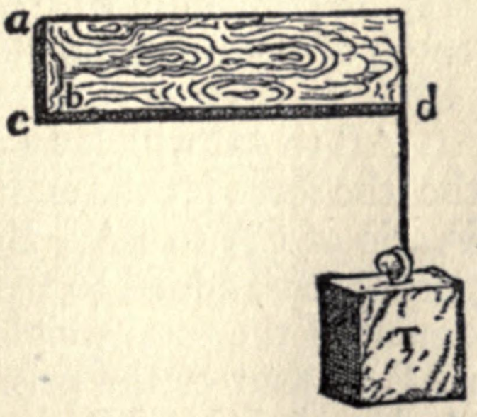
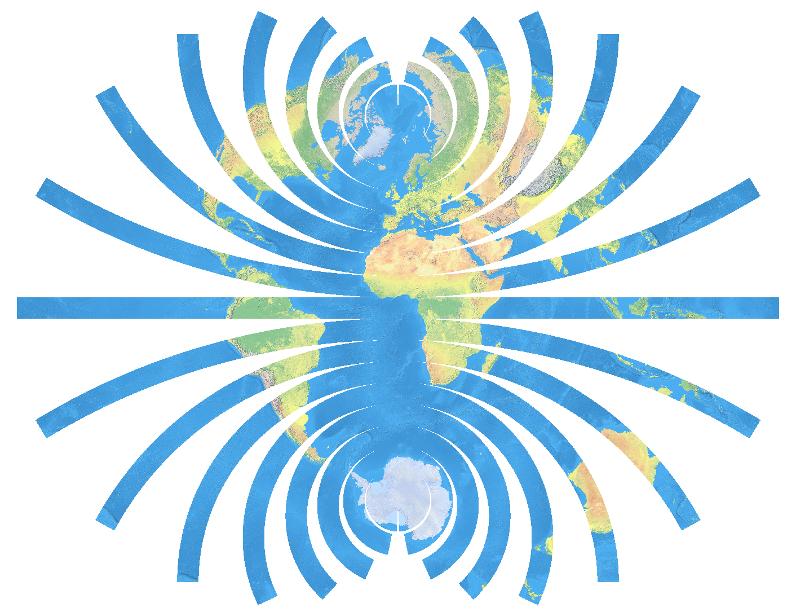

Gravity and the Geometry of Motion
==================================

Introduction
------------

Two hundred and fifty years after Newton devised his wildly successful interlocking theories of motion and gravity, Einstein realized there was a radically different way to think about them.  Instead of Newton's inverse square force of attraction between masses, Einstein proposed that mass bends time to produce the acceleration of gravity.  While Newton treats gravity like other forces, Einstein treats gravity differently.  Other forces extend through space and time, while gravity warps the connection between time and space.

Specifically, Einstein focuses on the fact that gravity produces identical acceleration for every body, independent of its size or composition, as Galileo taught before Newton.  In Newton's view, it could have been otherwise - gravity could have accelerated wood at a different rate than stone or gold.  Newton performed careful experiments with pendulums to show that the downward acceleration of gravity is, in fact, identical among different materials to within a tenth of a percent - three decimal places.  This independence of gravitational acceleration from material composition has now been confirmed to better than fifteen decimal places using test masses inside a specially designed satellite orbiting the Earth.  Einstein embraces these experimental results by postulating that the acceleration of gravity is a built-in property of the geometry of space and time - its gradient turns out to be the intrinsic curvature of spacetime.  Thus in Einstein's model, the acceleration of gravity is inevitably independent of material composition.

How can Einstein's bizarre explanation of gravity as curvature be equivalent to Newton's common sense explanation of gravity as force?  Answering that question is our goal here.  Before we get started, you must be warned that this discussion does not follow the historical order or context in which Einstein developed his theories of Special Relativity and General Relativity.  In fact, the curvature interpretation of Newtonian gravity presented here was developed by Cartan, who back-engineered Einstein's General Relativity to the low speed limit (e.g.- the speed of anything in the solar system) where Newton's laws of motion and gravity are very nearly exact.  To understand the full theory of General Relativity, starting from Cartan's version of Newton's theory is easier than jumping directly from Newton to Einstein.  Here we focus on the change in perspective from Newton's picture of gravity to Einstein's, rather than the details of the treatment of absurdly high speed motion.  In this low speed limit, the two theories really are exactly the same - Einstein just shows you can interpret Newton's laws very differently from what Newton intended, and still be consistent with the centuries of evidence supporting Newton's interpretation.

We open with a brief review of Newton's laws of motion, followed by a longer review Kepler's laws of planetary motion and Newton's theory of universal gravitation.  We continue with a discussion of Newton's concept of space and time, in which space is like the frames of a movie and time labels the frames.  World-lines of bodies tie the frames together, but the First Law of motion singles out a particular class of possible frame stackings as "inertial reference systems".  Next, we contrast Newton's global with Einstein's local interpretation of the First Law.  Both use the First Law as a straightedge for spacetime, but they disagree about which world-lines are straight in the case of gravity.  This tension leads Einstein to the strange concept of an intrinsically curved spacetime in which the connection between movie frames varies from place to place.  We close with a discussion of the local reformulation of Newton's inverse square law due and the matching local formulation of the laws of motion as the equations of fluid flow, which Einstein needs to complete his local theory of gravity.

Newton's laws of motion
-----------------------

Newton's masterpiece, "The Mathematical Principles of Physics" - Principia for short - begins with a Definitions section which includes a lengthy discussion of how he thinks about time and space.  In particular, Newton introduces or perhaps justifies his picture of absolute time and space, to which we shall return.  Immediately after these definitions, he presents his three laws of motion.  Paraphrased, they are:

First Law: A body at rest stays at rest, and a body in motion stays in motion in a straight line at constant speed, unless some net force acts upon it.

Second Law: The net force on a body is proportional to its acceleration and to its mass.

Third Law: To every action there is an equal and opposite reaction.  That is, if body A exerts a force on body B, then B exerts an equal and opposite force on A.

The Second Law is Newton's iconic formula F=ma, which serves as a definition of force or mass, or even, as we shall see, acceleration - at any rate a relation among the three things.

The Third Law is now called "conservation of momentum," which is at first glance the only actual assertion being made about the physical world - you can't push on something without it pushing back on you.

An illustration from Galileo's masterwork "Dialogues Concerning Two New Sciences" shows a weight suspended by a rope from a cantilevered beam.  The picture suggests a way to think about force as tension in a rope, which transmits force from one end to the other.

The tension will always produce equal and opposite forces at the two ends of the rope.  (Even when one side is winning a tug of war, the forces on the hands of the two teams are equal and opposite - it is the forces they are able to produce against the ground which differ.)  This is undoubtedly one of the pictures Newton had in mind when he formulated the Third Law: Imagine that any force between two bodies is transmitted by the tension of a thread (or compression of a rod) connecting them.  Much later, Faraday invented a similar picture of electric and magnetic field lines, which Maxwell showed act as innumerable tensioned threads connecting any two poles.  There is deep physics in the Third Law - it is a model for how bodies in the real world behave; it tells you the sense in which motion cannot be created or destroyed.

You may be puzzled by the First Law because it seems to be simply a special case of the Second Law, namely the case that the force and acceleration are both zero.  (Moving in a straight line at a constant speed, or not moving at all, is precisely what zero acceleration means.)  However, without the First Law, you don't really know how to measure acceleration - acceleration with respect to what?  You need some kind of a reference body you can take to be "at rest" - something relative to which you can measure position, hence velocity and acceleration.  "Relative to what?" is the question Newton is trying to answer with his lengthy discussion of absolute space preceding the laws of motion, and the purpose of the First Law is to answer that question.

The First Law tells you how to choose a reference body: Pick any body that has no net force acting on it - a free body.  If you have chosen your reference body according to the First Law, the Second Law tells your that any other free body will have zero acceleration relative to your reference.  That is, all free bodies move in straight lines at constant speed relative to one another, so no matter which free body you choose as your reference, all accelerations relative to it will be the same.  Thus, the physical content of the First Law for Newton is that acceleration is absolute - independent of whatever free body you choose as your reference for positions (and velocities).  But Einstein finds a loophole in the First Law, as we shall see.

Newton's universal gravitation
------------------------------

### Kepler's laws

Kepler's three laws of planetary motion distill millennia of astronomical observations, improving upon the already quite accurate ancient Greek system of epicycles described in Ptolemy's Almagest.  But unlike the Greeks, Kepler does not guess the distances to the planets; he surveys them, using pure geometry and a brilliant trick involving the periodicity of planetary orbits.  Working from naked eye observations alone before the invention of the telescope, Kepler discovered: (1) Planetary orbits are ellipses with the Sun at one focus and a fixed orientation with respect to the distant stars, (2) A radius drawn from the Sun to the planet sweeps over equal areas in equal times (so they move faster when closer to the Sun and slower when farther away), and (3) Comparing the orbits of the several planets, the cube of the major axis of their ellipse is proportional to the square of their orbital period.

Newton wrote Principia about three quarters of a century after Kepler.  Galileo had invented the telescope at essentially the same time Kepler was publishing his laws, and by Newton's time, astronomers knew that four moons of Jupiter and five moons of Saturn also obey Kepler's laws with respect to their planet; Kepler's laws of planetary motion had become Kepler's laws of orbital motion more generally.  (The constant of proportionality in the cube-square law is different for the Sun, Jupiter, and Saturn, however.)  After formulating the Second Law, F=ma, Newton would naturally ask what sort of force must be acting on the planets in order to keep them in their orbits?

### Centripetal forces and Keplerian orbits

To keep an object in circular motion (though ellipses, planetary orbits are very nearly circular) obviously requires a central force - a force directed toward the fixed point at the center of the orbit.  Just think about tying a stone to a string and whirling it in a circle.  The string is obviously pulling the stone directly toward the center - recall the purpose of the rope in Galileo's figure.  Hence it is not surprising that after stating his laws of motion, Newton turns his attention to how a body moves when the force on it is always directed toward toward some fixed central point - a centripetal force.  You can get non-circular orbits if you vary the tension in the notional string connecting the center point to the body by pulling in or letting out more string as it goes around, so the magnitude of the central force may vary, but the direction of the force is assumed to be toward a fixed center.

Newton's very first result is that for any centripetal force, the radius drawn from the center point to the body sweeps out equal areas in equal times, and the motion remains in a single plane containing the center point.  Thus, Kepler's second law of planetary motion is an immediate consequence of F=ma, assuming the force holding the planet in its orbit is always directed toward a fixed point.  Newton also proves the converse: If you observe any body to move such that its radius to some fixed point sweeps out equal areas in equal times, then the body must be experiencing a force always directed toward that fixed point.  Right out of the gate, Newton has shown that the planets experience a force always directed toward the Sun!  Furthermore, the moons of Jupiter always accelerate directly toward Jupiter, and the moons of Saturn directly toward Saturn!  Today, Kepler's equal area law is called "conservation of angular momentum"; again, it is a consequence of F=ma for any centripetal force.

Because of Kepler's equal area law, all possible motion under any centripetal force must happen in a single plane containing the center of force.  Furthermore, since the area swept out is proportional to time, area in the plane of motion can be taken as a surrogate for time, and the entire problem reduces to a study of curves in plane geometry.  Newton is very, very good at geometry, and he proceeds to work out exactly how the force (or rather acceleration, since the mass of the body is fixed) must vary from place to place in order for the trajectory of the body to follow half a dozen simple plane figures.

Needless to say, one of the figures he chooses is an ellipse from Kepler's first law of planetary motion.  That is, Newton asks, "How must the centripetal force on a body vary in order for its trajectory to be an ellipse with the center of force at one focus?"  Working through the geometry, he finds that the force must vary inversely as the square of the distance from the center.  He finds the same inverse square law is required for the body to follow a hyperbolic or parabolic trajectory with the center at one focus - any conic section.  (The hyperbola is interesting because one of its two branches is the case of a repulsive inverse square force; the other orbits all require attractive inverse square forces.)

Some other figures Newton works out are an elliptical trajectory with force directed to the center of the ellipse instead of to a focus, an Archimedean spiral trajectory with center at its endpoint, and a circular trajectory with the center on the perimeter of the circle.  These require, respectively, force directly proportional to distance, force inversely proportional to the cube of distance, and force inversely proportional to the fifth power of distance.  He's having so much fun you can feel his joy through all the Euclidean formality.

Now that Newton has shown an inverse square law of centripetal force is mathematically equivalent to Kepler's first two laws of planetary motion, all that remains is Kepler's cube-square law relating the orbits of multiple satellites around a common center.  For the case of circular orbits, the cube-square law is obvious, inasmuch as acceleration scales as distance divided by the square of orbital period, and itself scales inversely with distance squared.  In fact, the constant of proportionality in the cube-square law is the same as the constant of proportionality in the inverse square acceleration law, to within some factors of two pi.  To wrap up the case, Newton compares circular and elliptical orbits sharing a common inverse square acceleration law.  He shows that their orbital periods match when the major axis of the ellipse equals the diameter of the circle (which is also its major axis).

Hence, for any orbital shape, Kepler's third law means that all the planets (or moons) accelerate toward the Sun (or planet) according to a single inverse square acceleration law.  If you know how far anything is from the Sun, you know how fast it is accelerating toward the Sun.  Similarly, you know how fast any body accelerates toward Jupiter from its distance to Jupiter or toward Saturn from its distance from Saturn.

### Eureka! Universal gravitation

To put a cherry on top, Newton points out that the Moon is 60 Earth radii from the center of the Earth, and the fact that the Moon takes a bit more than 27 days to make each orbit (with respect to the stars) means that its acceleration toward the Earth is 3600 times less than the acceleration of gravity on Earth's surface.  But 1/3600 is the inverse square of 60, so if the gravitational force we feel here diminishes as the inverse square of the distance from Earth's center, it is exactly the force required to hold the Moon in its orbit!  Newton has not simply shown that an inverse square acceleration law is mathematically equivalent to Kepler's three laws of planetary motion, he has demonstrated that this inverse square force is none other than the force of gravity we have always known.  Not only are the planets moving according to F=ma like any stone we throw, but also the force holding planets in orbit is the familiar pull of gravity.  This is pretty easily the greatest Eureka moment in the history of human thought - Newton has literally connected heaven to Earth.

But there's more, much more.  From the moons of Jupiter and Saturn as well as our Moon and Earth, in addition to the planets and Sun, Newton has demonstrated that the Sun, Jupiter, Saturn, and the Earth each attracts any body in its neighborhood with an acceleration that decreases inversely as the square of distance from it.  It's a small step to imagine this inverse square law of gravity is an innate property of all bodies, even if it is an imperceptibly small force between any pair of bodies much smaller than planets.  Hence, Newton postulates that his inverse square law is a universal force of gravitation acting between any pair of bodies whatsoever.

Furthermore, Newton has only used his Second Law of motion to prove all of this!  What does the Third Law tell him about his inverse square law of gravity?

Since gravity accelerates all bodies at the same rate - an experimental fact - the Second Law means force of gravity must be proportional to the mass of the body being pulled, be it a small weight on Earth's surface, a moon, or a planet.  By the Third Law, that smaller body must be exerting exactly the same force as the gravity of the larger body exerts upon it - you must be pulling upward on the Earth with exactly the same force the Earth pulls downward on you according to the Third Law of motion.  That counterforce can be none other than the gravitational attraction of your own body, since it must vary inversely as the square of the distance from you!  Hence the force of gravity must be proportional not only to the mass of the body being pulled, but also to the mass of the body doing the pulling - that's the only way the force and counterforce can be equal and satisfy the Third Law.  Not only is the gravitational force a body experiences proportional to its mass, but the gravitational force it exerts on other bodies must also be proportional to its mass by the Third Law.  (The reasoning which led Einstein to the field equations of General Relativity is based on this intimate connection between gravity and conservation of momentum.)

Thus, the gravitational force between two bodies is proportional to the product of the two masses and inversely proportional to the square of their distance.  The constant of proportionality - Newton's gravitational constant - is the first universal constant ever discovered.  Newton computed its value when mass is measured in units of solar masses or Earth masses, but the experiment required to measure its value with mass in units of kilograms - measuring the gravitational attraction between two bodies with known masses in kilograms - is extraordinarily delicate, and wasn't successfully carried out until a century after Principia.

World-lines and the direction of time
-------------------------------------

### Movies, card decks, and world-lines

We very naturally think about motion as rapid succession of snapshots or frames, each capturing some group of objects at a single instant of time, because that is exactly how we make movies or videos or any animation.  When the snapshots are presented in rapid sequence, we interpret changes in position of the objects from frame to frame as motion.  Although the frames of a movie or video are two dimensional, it is easy to imagine a succession of three dimensional frames, each depicting some group of objects at a different instant of time.  Euclidean geometry governs each individual frame - that's exactly what Euclid was trying to capture - so we know all about straight lines, circles, distances, angles, and so on in each frozen snapshot.  The problem comes when we try to connect the successive frames of our movie, and that connection is what Newton is addressing with his discussion of absolute time and space.

For two dimensions of space, you can imagine each snapshot is reproduced on a card, where each card represents one instant of time.  For example, imagine positions the Sun and inner planets (as viewed from far above the ecliptic plane) at successive times are marked on each card, so you can label each card by the time of its snapshot.  When we talk about spacetime, we are talking about the whole deck, stacked in order, and we are interested in the geometry of that whole stack.  But when you place each card atop the previous one, how do you know where to put it?  These cards have no edges to line up.  In fact, in the case of the solar system cards, Ptolemy used the Earth to align successive cards the deck, while Copernicus used the Sun - geocentric stacking versus heliocentric stacking.  In general, you are free to slide the cards around however you wish: What does it mean to be "at the same place" at two different times?  Relative to the Earth? to the Sun? or to something else entirely?

However you stack the spatial slices, when you connect the position of any material body on one slice to its position on successive slices, you get a (possibly curved) line which runs out of the spatial dimensions through the time dimension.  This is called the world-line of the body.  Spacetime geometry is more about these world-lines than about the points (called events) along them.  When you use any particular body as your reference guide for stacking spatial slices, its world-line becomes a straight line which cuts through spacetime perpendicular to the deck in our card model, as does the world-line of any other body which is at rest relative to the first.  Bodies moving with constant velocity (speed and direction) relative to the reference body will also have straight world-lines, but tilted away from the perpendicular to the card deck.  The world-lines for other bodies will be distorted into various curves - in the solar system example every body except whatever you choose as a reference will corkscrew through the card deck.

### The direction of time

As you sit in your chair, you can easily point forward, backward, left, right, up, or down - corresponding to the three pairs of opposite directions in three dimensional space.  If you want to think about spacetime geometrically, then future and past must correspond to a fourth direction - your time direction.  Going back to the card deck analogy, the direction of time must punch through the deck, just like every world-line.  If you stack the card deck so that you and your chair are at rest, then your direction of time must be along your world-line, perpendicular to the cards in the deck.  But perhaps you look out your window and see someone driving by in a car.  Their world-line will be tilted as it cuts through your card deck - thus, their direction of time is not the same as yours!  The direction of time varies from one observer to another, depending on how fast and in what direction they are moving.

This is no different from the fact that the spatial directions like left or right depend on what direction you are facing.  The direction of time, like the direction rightward, is relative.  Velocity measures the tilt of world-lines, hence the tilt of the time direction relative to some particular card stacking, similar to the way that angle (or more accurately, slope) measures the tilt of rightward for you relative to rightward for someone standing nearby.  If their rightward is different from yours, it means they are facing in a different direction.  If their time direction is different from yours, it means they are moving with a different velocity.

To summarize, the direction of time runs along world-lines, and motion tilts the direction of time in the same way that rotation tilts spatial directions.  But in addition to relative directions like rightward, we also have absolute directions like north (taking "north" in its astronomical sense to mean Polaris-ward).  Is there an absolute direction for time?  Newton says yes - that's what his discussion of absolute space and time is about.  However, he concedes that, like north, there is an arbitrariness about exactly what choice you make for the standard direction of time.  There is no preferred state state of motion, any more than there is a preferred direction in space.

Newton suggests using the world-line of the center of mass of the entire solar system, which is called the solar system barycenter (SSB), as a practical realization of an absolute direction of time.  He proves that, according to the laws of motion, this point moves at a constant velocity relative to any distant body which has no forces acting upon it.  Note that the center of the Sun moves around the SSB as the configuration of the planets change due to their various orbits.  Thus Newton's solar system model is not heliocentric, a fact generally overlooked.  Newton has rendered the revolutionary ideas of Copernicus moot (if not silly) less than a century and a half after that controversy ignited.  The world-line of the solar system barycenter, always within about a solar diameter of the center of the Sun, is the practical absolute direction of time to this day, used by all modern astronomers.

Incidentally, the practical absolute direction in space, called the International Celestial Reference Frame or ICRF, is based on the directions to several hundred extremely distant quasars evenly scattered throughout the sky.  This is not how Newton could have dreamed of defining spatial directions, so his use of the SSB as a reference time direction has, at least in some respects, outlasted his reference spatial directions.

### Timelike and spacelike directions

Notice that although the tilt of a world-line - the velocity of the body - is completely unrestricted, it cannot tilt backward in time.  The direction of time differs from any spatial direction in that particular, since you can reorient yourself in space to make any direction at all be rightward.  The reason is simple: you would never interpret a world-line to point backward in time - if the body were following such a world line, you would interpret it as moving forward in time with the opposite velocity.  But even including both directions along it, no world-line can point directly along any spatial direction.  Again, the reason is simple: no body can be in two (or multiple) places at once.  Hence, there are technically two different kinds of directions in spacetime, called timelike directions - directions a world-line can lie along - and spacelike directions - the directions in ordinary space at any given instant of time.

Einstein was the first to realize that this structure is not quite correct when bodies move ridiculously fast, which he did a decade before his theory of gravity.  It turns out that the distinction between timelike and spacelike directions in spacetime is still important, but that the spacelike directions are not quite restricted to directions in ordinary space, since no world line can tilt faster than light.  But we will continue to ignore that high speed detail of the story here - it is a plot complication that distracts from the more important new perspective Einstein brings the story of gravity.

Using the First Law as a straightedge
-------------------------------------

### A straightedge for world-lines

So far, spacetime isn't much of a geometry.  A collection of world-lines seems more like a tangle of spaghetti; the shape of each strand depends entirely on how you choose to stack the spatial slices of spacetime - how you align successive cards in the deck.  The curviness of the world-lines depends on the stacking, so if you had a rule for determining which world-lines are "straight", it would greatly constrain how you could stack the cards.

In ordinary geometry, Euclid's first two postulates declare that straight lines exist, that is, that there is such a thing as a straightedge.  However, the practical embodiment of those two postulates is left to the reader.  Newton writes very beautifully about the relation between this abstract geometry and practical mechanics in the preface to Principia:

"To describe right lines and circles are problems, but not geometrical problems. The solution of these problems is required from mechanics; and by geometry the use of them, when so solved, is shown; and it is the glory of geometry that from those few principles, brought from without, it is able to produce so many things. Therefore geometry is founded in mechanical practice, and is nothing but that part of universal mechanics which accurately proposes and demonstrates the art of measuring."

With his laws of motion - he also calls them axioms - Newton clearly intends to extend these mechanical underpinnings of Euclidean geometry from position in space to motion in spacetime.  If we had a straightedge for spacetime, we'd have the beginnings of a real geometry of spacetime.

But the First Law is exactly the straightedge we need for world-lines!  If you can find any body which has no net forces acting upon it, the First Law says it is either at rest or moving with constant speed and direction - in either case, its world-line must be a straight line through spacetime.  This drastically narrows down the ways you are permitted to stack the spatial snapshots to build up spacetime, since every body experiencing no net force can at most be moving at a constant speed in a fixed direction relative to your reference body.  The remaining arbitrariness is just like Euclid's straightedges - you can tilt your spacetime straightedge to make it point in whatever time direction you choose.

Now Newton presumes that any body very far from any other will have no significant external force acting upon it; by the First Law, such a remote body must have a straight world-line.  This single remote body may therefore serve as a reference, determining how to stack the spatial slices throughout all of spacetime.  He demonstrates that the center of mass of the entire solar system (the SSB) must move in a straight line through spacetime with this same stacking; thus, to the extent that the solar system is far from anything else, he doesn't need to rely on a hypothetical remote body to stack the spatial slices.  With this global stacking, the world-lines of the planets and satellites are all curved, corkscrew-like paths through spacetime.  Some force must causes those world-lines to curve, and we have seen how Newton uses his Second and Third Laws to work out universal gravitation.

### First Law redux

Despite the wild successes of Newtonian gravity, Einstein is uneasy with Newton's interpretation of the First Law: When you are falling, you feel no forces acting upon you - orbiting astronauts are weightless!  Why shouldn't the First Law require that you be moving in a straight line at a constant speed?  Any material body will develop internal stresses when a net external force is applied to its surface, like the rope in Galileo's illustration of a suspended weight.  Newton's answer to this criticism is that gravity acts directly on each small part of the material in a body, so unlike a rope that pulls only on its attachment point, gravity produces no differential forces inside a falling body and hence no internal stresses.

In a way, Newton's answer works a little too well - it applies not only to the individual parts of a single body which are at rest relative to one another, but also to any nearby bodies that may be falling at different instantaneous speeds - these also experience the same gravitational acceleration as the first body, so relative to that body, they continue moving in straight lines with fixed directions.  That is, any collection of freely falling bodies nearby that first body obey the First Law locally among themselves.  Einstein points out that locally this collection of nearby small objects would look exactly the same if the whole collection were removed to a remote location, but observed from an accelerated vantage point.  In other words, at least locally, the action of gravity is indistinguishable from adopting the viewpoint of an accelerated observer.

Interestingly, Newton actually calls attention to this feature of the relative motion of a collection of objects in Principia as well (Corollary VI after the Laws of Motion).  This concept is crucial for understanding why the system of moons around any planet orbit according to Kepler's laws at the same time that the planet itself orbits the Sun according to those same laws, which is why Newton takes care to point it out.

Einstein takes this principle to the extreme by proposing that instead of Newton's global stacking of spatial slices to build a complete model, we should allow ourselves to use many local stackings, and figure out how to piece them together into a complete whole.  Newton imagines a global connection between snapshots, while Einstein imagines many local connections, so different parts of each snapshot connect to corresponding parts of adjacent snapshots differently.  From a global perspective, this is obviously dramatically more complicated than Newton's picture.  Einstein's local interpretation of the First Law is arguably more practical - if a body has no internal stresses, you can use it as a reference body locally.  Weightlessness is the test for world-line straightness.  That is, any body in free fall is moving in a straight line through spacetime locally.

Einstein applies the First Law very differently from Newton; both recognize that it defines straightness of world-lines, but come to very different conclusions about which world-lines are straight.  For both Newton and Einstein, the SSB world-line is straight.  With his global reading of the First Law, Newton concludes that the planets accelerate toward the Sun and therefore have curved world-lines due to the force he identifies as gravity.  With his local reading of the First Law, Einstein concludes that any body in free fall experiences no net force and therefore is not accelerating; the planets and all their satellites have straight world-lines.  These different interpretations of the First Law - local versus global - lead to very different perspectives on the nature of gravity - force versus spacetime curvature.

Does the ground accelerate upward?
----------------------------------

### Bouncing balls

Let's look at a concrete example: Watch two balls drop from different heights and bounce.  Physics lecturers often use a ball bearing dropped onto a heavy steel plate, which can bounce for several minutes, returning to nearly the same height on successive bounces - we're imagining two such ball-and-plates next to each other on the ground.  Except for the instants of contact, both balls are in free fall.  The motion is in one spatial dimension - vertical - so we can easily draw the world-lines of these balls in spacetime by plotting time horizontally.  Each of our one dimensional spatial snapshots records three vertical positions - the ground (where the plates they bounce on sit) and the two balls.

Newton says that the force of gravity constantly accelerates each ball downward, so its trajectory on each bounce curves in a parabola through spacetime.  The ground, on the other hand, remains at a fixed position, held there by the gradually increasing pressure in deeper and deeper layers of rock under it, ultimately extending to the center of the Earth.  In order to judge that the balls are accelerating downward, Newton implicitly uses the ground (or the center of the Earth) as his reference body to stack the snapshots, so that he plots the ground as a straight horizontal world-line in our diagram.

Einstein says that since the balls are in weightless free fall between bounces, unstressed by any external forces, we should stack the snapshots so that every bounce of both is a straight world-line rather than a parabola.  The velocity or tilt of these world lines of course change at the moment of each impact, when the ball certainly does experience very large internal stresses and thus changes velocity very rapidly.  In any stacking with this property, the ground will follow an upward curving parabola, that is, the ground is accelerating upward at one gee in Einstein's picture of spacetime.

Notice that with a single stacking, Einstein turns every bounce of both balls into a straight segment of their world-lines, despite the fact that their relative velocities differ and change with each bounce.  This is because the acceleration of every ball in Newton's stacking was one gee downward, no matter what its instantaneous velocity.  Notice that Einstein has a very simple explanation for Galileo's observation that all objects accelerate downward at the same rate relative to the ground: It's the ground that accelerates upward at one gee - the acceleration doesn't belong to the freely falling objects at all - their world-lines are all straight!  When Newton keeps the ground "at the same place" for all times, he has chosen an upwardly accelerating reference frame, so naturally anything he observes from that viewpoint will appear to share the opposite downward acceleration.

But what happened to gravity in Einstein's picture?  If there is no such thing as a force of gravity, what keeps the planets orbiting the Sun?  The problem is that Einstein's stacking of spatial slices only works as long as Newton's acceleration of gravity does not change from place to place.  The Earth is a globe, after all, and on the opposite side from where you sit, their down is your up - the acceleration of gravity is in completely the opposite direction.  Hence Einstein's stacking can only apply locally - he has to use a different stacking on the opposite side of the Earth.  Although the downward acceleration of gravity remains pretty nearly the same within a few kilometers of where you are sitting, it begins to change at distances which are a significant fraction of the size of the Earth.  So you can use Einstein's stacking within a few kilometers (and a few seconds) of where (and when) you are, but you cannot use it globally.

### Down the deepest hole

Imagine that the Earth weren't spinning, and that you drill a hole straight through its center and out the opposite side.  Newton's acceleration of gravity toward the center must decrease gradually as you move down the hole to zero at the center, then grow back to one gee in the opposite direction when you reach the other end of the hole.  Splitting the hole into a number of segments each a few kilometers long, Newton's acceleration of gravity changes very little within each segment, so you can apply Einstein's stacking to each segment individually.  This produces a whole family of parabolas, each a few kilometers in vertical extent but covering as great an extent of time as you please.  The curvature of the parabolas gradually decreases until you reach the central one, which is a straight horizontal line - Einstein's stacking and Newton's stacking agree at the center of the Earth.  Continuing down the hole, Einstein's parabolas gradually become more and more curved downwards.  This is what Einstein means by a local stacking of snapshots - each local stacking is almost but not quite consistent with adjacent stackings, causing the gaps between adjacent parabolas in this example.  (Continuing above the surface of the Earth the parabolas begin to overlap, so that's harder draw, but the idea is the same.)

What happens when you drop a ball down the hole?  In each of the parabolic strips, we know that its world-line will be straight.  But what happens when its world-line reaches the edge of one of the gaps in our diagram?  Despite the gaps between parabolas, adjacent edges really represent the same curved world-line, just stacked slightly differently.  Where the straight world-line of the ball meets the curved world line of the edge, there is a relative velocity between ball and edge, which is the difference in slope in our space-time diagram.  That difference in velocity or slope must be the same on the other side of the gap, which means the slope of the ball's world-line will be tilted toward Earth's center as it crosses each gap in our local stacking diagram.  Although within each parabolic strip the ball moves in a straight line, the slope of that line jumps as it crosses from one strip to the next, so by the time it reaches the central strip it is moving downward quite rapidly.  After crossing the center, it slows and will continue oscillating between the two ends of the hole indefinitely.

This picture is insanely complicated compared to Newton's picture of the same process - for Newton the ball experiences a downward force that decreases to zero at the center then reverses, so it naturally oscillates between opposite ends of the hole in the same way it would if attached to a spring.  Newton has no gaps to jump or differences in slope to keep track of - his global stacking has a dramatically simpler spacetime geometry than Einstein's local stacking.

The advantage of Einstein's picture only shows up when the deck-of-cards structure of spacetime (really Newton's concept of absolute time) breaks down for extremely high speed motion, which we are not considering here.  For now, we note that within each parabolic strip of spacetime in the local stacking picture, we don't need to understand how gravity changes the motion of small bodies - they simply move in straight lines like free bodies; gravity only enters in how the local strips are connected.  Thus, if you have good local models of how all the forces besides gravity affect small bodies, you can use those models to figure out the motion of everything within each parabolic strip.

Gravity only enters in determining how the strips fit together; it has been reduced to a purely geometrical problem - the velocity of bodies in free fall changes only when they cross from one strip to the next.  Einstein called this approach the Equivalence Principle, and he figured out how to track the velocity changes even in the high speed limit.  With the Equivalence Principle gravity operates by changing the geometry of spacetime itself - how the spatial slices are connected - rather than as a force between bodies like all other interactions.  In the mathematical jargon of curved spacetime, Newton's three components of the acceleration of gravity are called connection coefficients, or even more frighteningly, Christoffel symbols.

Intrinsic curvature of spacetime
--------------------------------

Although each of the parabolic strips appears curved in Einstein's interrupted spacetime diagram of a ball dropping down the deepest hole, that is only because the edges of the strips have been taken to be points at constant distance from the center of the Earth.  The whole idea is that Einstein considers any such point to be accelerating upward (apart from the point at the center).  Any body freely falling down the hole follows a perfectly straight line within every strip.  Thus, the curvature of the strips in this diagram is not what Einstein means by spacetime curvature - the curvature of the strips is merely the acceleration of local sections of the hole wall.

Spacetime curvature, as Einstein wants you to picture it, is the fact that gaps (or overlaps in other cases) appear between the individual strips.  The width of these gaps is proportional not to the curvature of the individual strips, but to the slight change in curvature between each strip and its neighbors.  That is, the gaps depend not on the local acceleration of (Newtonian) gravity, but on its gradient, that is, on how rapidly the acceleration of gravity is changing from place to place.  Einstein's spacetime curvature is the gradient of Newton's gravitational acceleration.  In mathematical jargon, that gradient of acceleration is called the Riemann curvature tensor (technically, the non-zero components of that tensor).

This sort of compound curvature - the changes in curvature from one strip to the next in our example - is called intrinsic curvature.  Gauss identified and began studying intrinsic curvature of two dimensional surfaces, and left his student Riemann to generalize his work in several important respects, to both higher dimensions and a more general notion of distance.  Einstein could use Riemann's geometry as the mathematical framework for his physical picture of curved spacetime a century later.

Another simple special case is the two dimensional geometry of the surface of a sphere.  You are very familiar with this case from geography: Flat maps a few kilometers on a side are exceedingly useful for finding your way around locally, but as you try to piece them together to display larger and larger regions, you soon realize that they don't quite fit together perfectly, because the surface of the Earth is not flat.  If the Earth were cylindrical, your local maps would still fit together perfectly, because you know you can easily roll a flat sheet of paper into a cylinder without crinkling it.  The problem with the globe is that it curves in both directions, while the cylinder is only curved along one direction.  This is the compound or intrinsic curvature of a surface that Gauss studied.

A flat map of the entire globe always splits open, like when you try to flatten an orange peel.  The gaps that open when you try to flatten a world map are unavoidable - cartographers call them interruptions - if you want the map to be undistorted.  There are many ways to place the interruptions - some of the art of cartography is choosing interruptions to support the purpose of the map.  Here is a global map (based on the polyconic projection) with a rather ugly choice of interruptions, in which the edges interruptions follow lines of latitude, so the interruptions are in the lines of longitude:

As you can see, this map of Earth's surface strongly resembles the interrupted map of spacetime for our deepest hole example.  Time and vertical position are analogues of longitude and latitude, respectively.  Instead of parabolas, the world map strips are curved in circles, but apart from that the resemblance is striking.  Lines of latitude are curved toward the nearest pole in this flattened diagram, except for the equator, which is straight.  And, in fact, if you start walking due east and keep walking in a straight line, your latitude inevitably bends toward the equator, and you end up following a great circle.  The black line shows a great circle running between 50 degrees north and south latitude, and it is indeed a straight line in every strip.  In the same way, if you begin at rest and advance in time along a straight world-line, you inevitably accelerate toward the center of the Earth.

From Einstein's perspective, by leaving out the interruptions Newton has inevitably distorted spacetime, in the same way that you must inevitably distort a world map by drawing it on a flat surface without interruptions.

Local formulation of inverse square law
---------------------------------------

Local formulation of the laws of motion
---------------------------------------

Conclusion
----------

